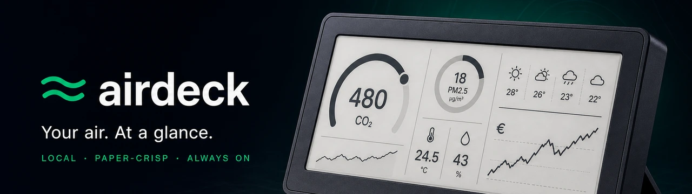
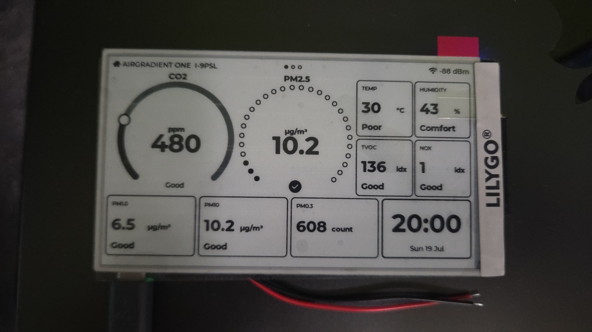
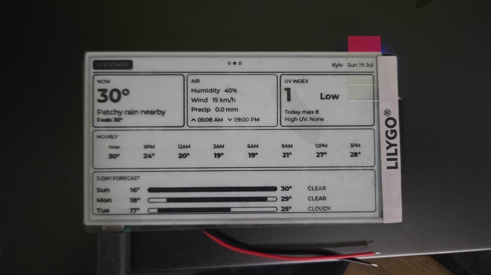
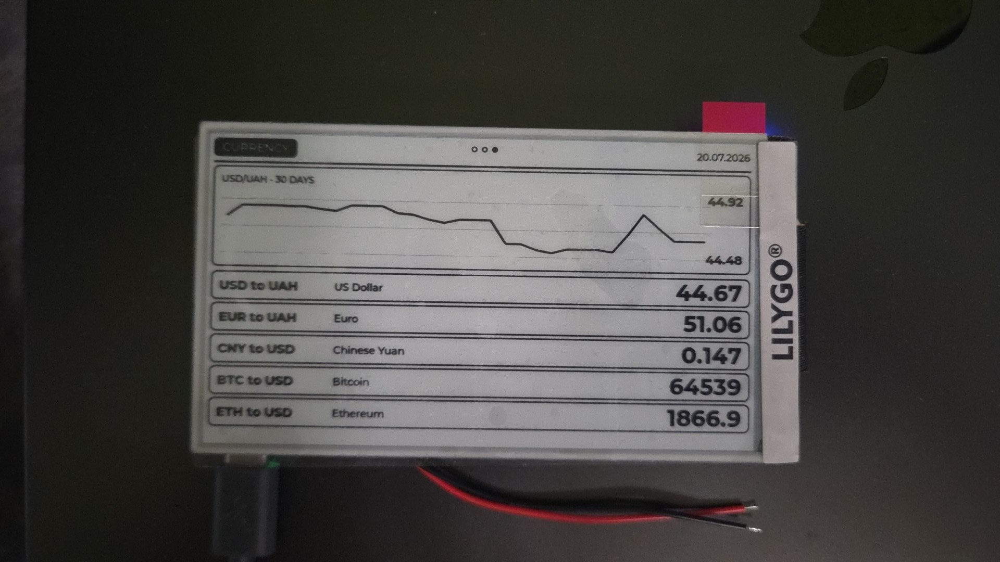
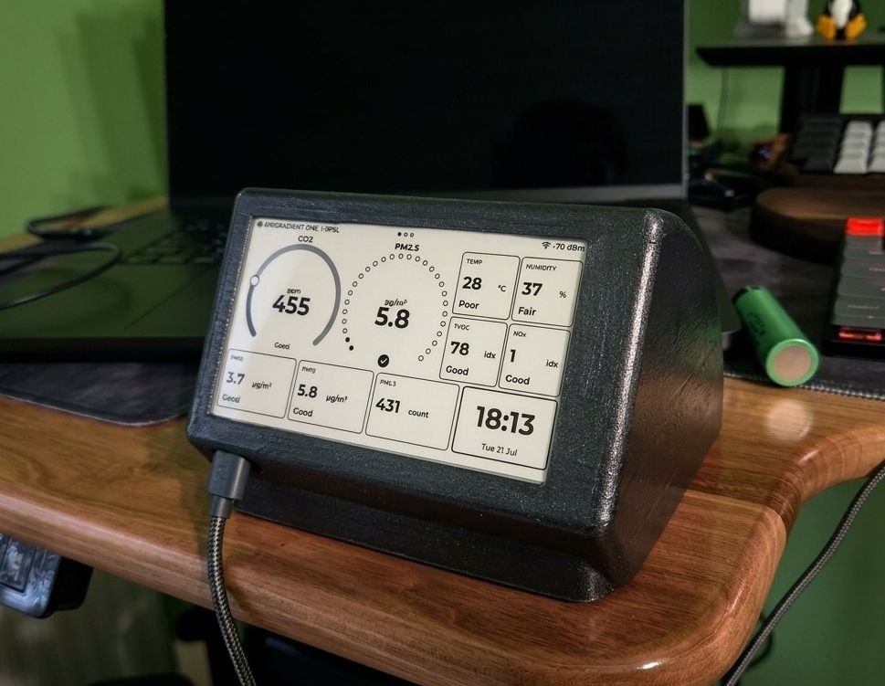
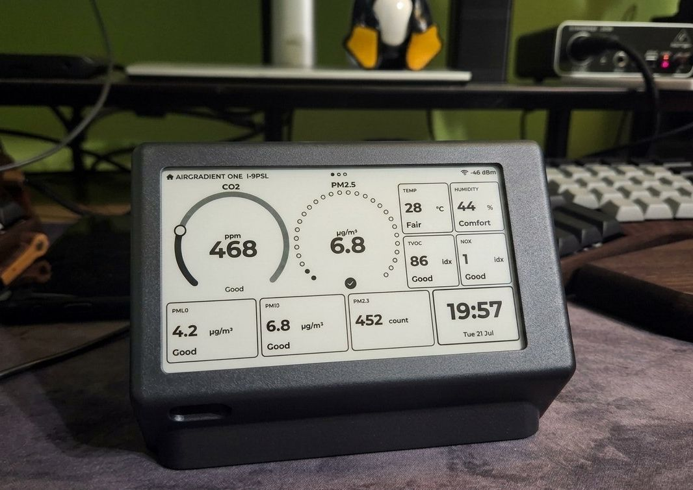
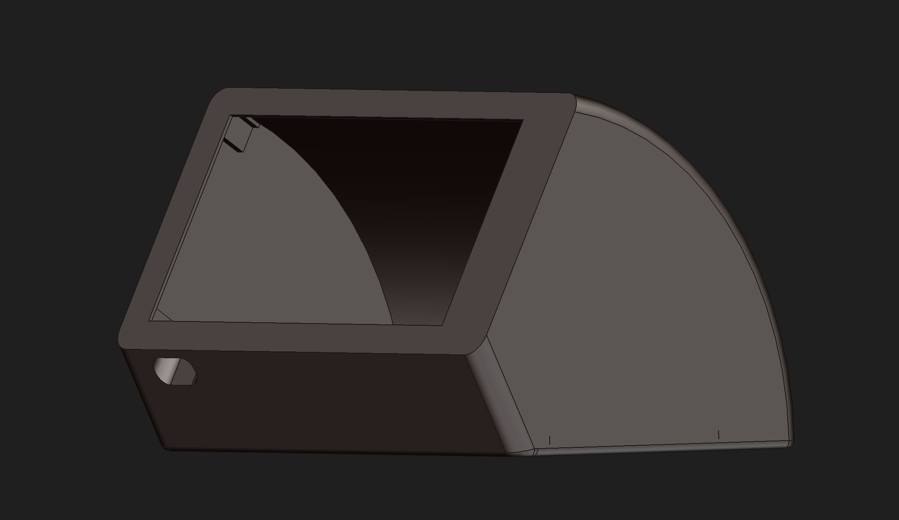

<div align="center">



<br>

[](https://github.com/worxbend/airgradient-papr/actions/workflows/ci.yml)
[](https://github.com/worxbend/airgradient-papr/actions/workflows/release.yml)
[](https://github.com/worxbend/airgradient-papr/releases/latest)


[](LICENSE)

**No cloud. No app. No subscription.** 🔒 Just your air — plus weather and money — rendered paper-crisp on a screen you can read from across the room. 📈



<br><br>

<a href="https://youtu.be/1xlhLZY1_Wo" title="Watch airdeck in action">
  
</a>

<br>
<sub>▶️ <a href="https://youtu.be/1xlhLZY1_Wo"><strong>Watch it run</strong></a> — 60-second demo</sub>

</div>

---

## Contents

- [Why I built this](#-why-i-built-this-)
- [What it actually is](#-what-it-actually-is)
- [The AirGradient bit](#-the-airgradient-bit-the-whole-point-)
- [The pages](#-the-pages-️)
- [Hardware](#-hardware-)
- [Flash it — no toolchain needed](#-flash-it--no-toolchain-needed-)
- [Build from source](#-build-from-source-)
- [Configuration reference](#-configuration-reference-️)
- [Local API](#-local-api-)
- [Under the hood](#-under-the-hood-️)
- [Development](#-development-)
- [Contributing](#-contributing-)
- [Enclosure](#-enclosure-)
- [Gotchas worth knowing](#-gotchas-worth-knowing-)
- [Credits & kin](#-credits--kin-️)

---

##  &nbsp;Why I built this 💡

Okay, real talk. I've got my **AirGradient ONE** mounted on the wall right next to my desk. 🧑‍💻 Perfect spot… except it's basically *behind me* — out of my line of sight while I'm actually working. So to check the air I'd have to spin my chair around and squint at the sensor's tiny onboard screen. Annoying.

I already built myself little companion apps — one for my **phone** 📱 and one for **Linux** 🐧 — so I could peek at the readings without getting up. Nice. Problem solved, right?

Nope. Classic plot twist: I'm sitting in **another room, no phone on me**, and I suddenly want to know what the air in my office is doing. Can't. 🙃

So I did the reasonable-person thing and built a **portable e-ink terminal** that just… sits there and shows me. No phone, no app, no getting up, no glare. Grab it, glance at it, done. **That's airdeck.** ✨

---

##  &nbsp;What it actually is

**airdeck** is standalone firmware for a **LILYGO T5-4.7″ ESP32 e-paper** board that adopts your AirGradient ONE and gives it the panoramic, zero-glare, always-on dashboard it deserves — talking to the sensor **entirely over your LAN** via its local API. 🏠

Then it got greedy 😎 and picked up two more tricks: **outdoor weather + forecast + UV**, and **live FX & crypto rates**. Because a screen this nice shouldn't only do one thing.

<div align="center">

&nbsp;&nbsp;

</div>

---

##  &nbsp;The AirGradient bit (the whole point) 🟢

airdeck speaks the **AirGradient ONE local-server API** — no AirGradient cloud account, no internet round-trip:

```
GET http://<your-monitor-ip>/measures/current   →   JSON, every 30 s
```

Every field the I-9PSL exposes lands on the panel:

| 🫁 Air | 🌡️ Comfort | 🧪 Chemistry | ℹ️ Meta |
|---|---|---|---|
| CO₂ (ppm) | Temperature | TVOC index + raw | firmware / model |
| PM1.0 / PM2.5 / PM10 | Humidity | NOx index + raw | boot count · LED mode |
| PM0.3 particle count | (compensated too) | | RSSI |

…all classified with **US EPA AQI** (PM2.5) and per-metric health bands (Good / Moderate / Elevated / Unhealthy). CO₂ and PM2.5 — the two with the clearest thresholds — get their own **gauges**. 🎯

> **Prereqs:** AirGradient firmware **≥ 3.0.10** with the local API on, and a **DHCP reservation** so the monitor's IP never drifts. That's it. ✅

Big respect to **[AirGradient](https://github.com/airgradienthq)** for building open, hackable, honest hardware. 🙏

---

##  &nbsp;The pages 🖥️

Three full-screen pages, flipped with the board's three buttons — **◀ prev · ⌂ main · next ▶** — with a little paging dot indicator up top.

- **1️⃣ AirGradient** — CO₂ as a sweeping **arc gauge with a knob**, PM2.5 as a **dotted ring**, a 2×2 tile block (temp / humidity / TVOC / NOx), a PM detail row, and a big clock. 🕗
- **2️⃣ Weather** — current conditions + humidity / wind / precip / sun + **UV** (index, band, today's max, high-UV window) + an **8-slot hourly strip** + a **3-day forecast** with range bars. Auto-geolocated 📍, no API key.
- **3️⃣ Currency** — a **30-day USD→UAH chart** 📉 over live rows: **USD→UAH · EUR→UAH · CNY→USD** (NBU) and **BTC→USD · ETH→USD** (CoinGecko).

> On boot, a 🌀 **splash screen** fetches every data source first, *then* renders the pages fully-formed — no half-empty screens.

---

##  &nbsp;Hardware 🧰

| Part | Model | Qty | Notes |
|---|---|---|---|
| 🧠 **LILYGO T5-4.7″ V1** | ESP32-**WROVER-E**, 16 MB flash, 8 MB PSRAM, ED047TC1 960×540 16-gray e-paper | 1 | the brain and the face |
| 🟢 **AirGradient ONE** | I-9PSL | 1 | your air sensor, on the same Wi-Fi |
| 🔌 USB-**A→C** data cable | — | 1 | ⚠️ *not* C-to-C — the board lacks CC pulldowns and won't enumerate |
| 🔋 *(optional)* 3.7 V LiPo | JST-PH connector | 1 | **check polarity with a multimeter first!** JST-PH pigtails vary |

---

##  &nbsp;Flash it — no toolchain needed 📦

Don't want to install a build system? Every tagged release ships a **single-file factory image** (`airdeck-factory-<version>.bin`) — bootloader, partition table, and app already merged, ready to write at address `0x0`.

1. Grab the latest `airdeck-factory-*.bin` from the [**Releases page**](https://github.com/worxbend/airgradient-papr/releases/latest).
2. Plug the board in with a **USB-A→C data cable** (shows up as `/dev/ttyUSB0` on Linux, a `COM` port on Windows).
3. Write it with [esptool](https://docs.espressif.com/projects/esptool/) — a tiny Python utility, installable with `pip install esptool`:

```bash
esptool.py --chip esp32 --port /dev/ttyUSB0 write_flash 0x0 airdeck-factory-<version>.bin
```

> ⚠️ **One catch:** Wi-Fi credentials and your monitor's IP are **compiled into the firmware** — there's no setup portal. The release image ships with placeholder credentials, so it will boot and show the UI but won't connect to anything. To point it at *your* network and *your* AirGradient, do the (painless, promise) [build from source](#-build-from-source-) below.

---

##  &nbsp;Build from source 🚀

```bash
# 1. Grab the code + PlatformIO
git clone https://github.com/worxbend/airgradient-papr.git && cd airgradient-papr
pip install platformio

# 2. Tell it about your Wi-Fi + monitor
cp include/config.example.hpp include/config.hpp
$EDITOR include/config.hpp          # SSID, password, http://<monitor-ip>/measures/current, timezone

# 3. Sanity-check the sensor is reachable
curl http://<monitor-ip>/measures/current   # should spit JSON

# 4. Flash it 🔥  (board on /dev/ttyUSB0)
pio run -e t5-epd47-v1 -t upload

# 5. Watch it wake up
pio device monitor
```

```text
[airdeck] boot
[boot] PSRAM: 4192123 bytes free
[net] ok #1  CO2=480 PM2.5=10.2 T=30 RH=43
[wx]  Kyiv 30C UV 1 Patchy rain nearby
[cur] USD=44.67 EUR=51.06 BTC=64539 hist=32
```

**🛰️ OTA:** once it's on Wi-Fi it advertises **ArduinoOTA**, so re-flashing never needs the cable again:

```bash
pio run -e t5-epd47-v1 -t upload --upload-port airdeck.local   # no USB needed
```

### Build environments

| env | target |
|---|---|
| `t5-epd47-v1` | **default** — the WROVER-E board, USB always-on |
| `t5-epd47-v1-batt` | battery deep-sleep single-shot profile |
| `native-test` | host unit tests for `domain/` |
| `diag` | minimal boot diagnostic — isolates board/PSRAM issues, no libraries |

---

##  &nbsp;Configuration reference ⚙️

Everything lives in `include/config.hpp` (copied from [`include/config.example.hpp`](include/config.example.hpp), gitignored). All values are **compile-time constants** — no captive portal, no runtime provisioning. Change a value → rebuild → flash.

### Wi-Fi & data sources

| Constant | Default | What it does |
|---|---|---|
| `kWifiSsid` / `kWifiPass` | — | your Wi-Fi credentials. **2.4 GHz only** — the ESP32 has no 5 GHz radio |
| `kMonitorUrl` | `http://192.168.1.21/measures/current` | full URL to the AirGradient's local API — use a DHCP reservation |
| `kMonitorSerial` | `""` | optional monitor serial for the mDNS fallback (`airgradient_{SERIAL}.local`); empty = URL only |
| `kLatitude` / `kLongitude` | `0.0` | weather location; `0/0` = auto-detect via IP geolocation |
| `kWeatherPollSeconds` | `600` | weather/UV poll cadence (10 min) |
| `kCurrencyPollSeconds` | `1800` | FX/crypto poll cadence (30 min) |
| `kPollSeconds` | `30` | AirGradient poll cadence (valid range 15–300 s) |

### Display refresh guards (panel protection)

One full e-paper refresh blocks the UI for ~1 s and peaks at ~950 mW, so airdeck rations updates no matter how chatty the data gets:

| Constant | Default | What it does |
|---|---|---|
| `kMinRefreshIntervalSeconds` | `60` | hard floor between panel updates; 60 s matches the HH:MM clock — raise to `300` for a quieter panel at the cost of a staler clock |
| `kForcedRefreshMinSeconds` | `3` | floor for button-initiated refreshes — paging feels instant, mashing can't burn one waveform per press |
| `kUiTickSeconds` | `15` | how often page models recompute (CPU only — never touches the panel) |
| `kDeGhostRefreshSeconds` | `3600` | full repaint backstop to clear e-paper ghosting even when nothing changed; `0` disables |

### Fault recovery

| Constant | Default | What it does |
|---|---|---|
| `kWatchdogSeconds` | `60` | hardware task watchdog on the UI task — reboots if the panel driver deadlocks |
| `kNetStallRebootSeconds` | `600` | reboot if the network task stops making progress |
| `kRefreshStarveRebootSeconds` | `600` | reboot if heap fragmentation starves the panel refresh gate this long — otherwise a permanently closed gate means a silently frozen screen with Wi-Fi still up |

### Behaviour & clock

| Constant | Default | What it does |
|---|---|---|
| `kNightStartHour` / `kNightEndHour` | `23` / `7` | night window (start inclusive, end exclusive) |
| `kFahrenheit` | `false` | temperature unit |
| `kGmtOffsetSec` / `kDstOffsetSec` | `0` / `0` | timezone offset from UTC in seconds for the on-screen clock (e.g. UTC+3 = `10800`) |

### Battery profile (`t5-epd47-v1-batt` only)

| Constant | Default | What it does |
|---|---|---|
| `kBatteryPollSeconds` | `900` | wake cadence for the wake→poll→render→deep-sleep loop — 30 s wakes would flatten a LiPo in ~a day |
| `kBatteryFullRefreshEvery` | `4` | force a full redraw every Nth wake even if data is unchanged (~hourly); `0` disables skip-unchanged |
| `kBatteryLowSleepSeconds` | `1800` | how long to sleep when the pack is too low to safely drive a refresh |

---

##  &nbsp;Local API 🌐

While it's judging your air, airdeck also serves a tiny HTTP API of its own on port 80 (plus ArduinoOTA) at `airdeck.local`:

| Endpoint | What it does |
|---|---|
| `GET /` | plain-text hello + endpoint listing |
| `GET /health` | JSON status: uptime, free heap, poll stats — perfect for a Home Assistant / Uptime-Kuma probe |
| `GET /repair` | trigger an on-demand full de-ghost repaint (safe: the handler only flags the request; the UI task runs it through the same refresh guards at the next safe slot) |

```bash
curl http://airdeck.local/health   # is it alive, and how alive?
curl http://airdeck.local/repair   # screen looking ghosty? scrub it clean
```

---

##  &nbsp;Under the hood 🏗️

- **Hexagonal-ish** layout: a pure, host-tested `domain/` (AQI math, health banding, trend) with thin `adapters/` (HTTP, e-paper guard, buttons, net services) and `ui/` pages.
- **Two FreeRTOS tasks + a mailbox** — networking on core 0, LVGL on core 1, no shared locks.
- **LVGL 9.2** rendering **L8 → 4 bpp**, its heap pool living in **PSRAM** so Wi-Fi + the e-paper driver keep internal RAM to themselves.
- **Panel-care baked in**: power discipline, full-refresh cadence, temperature clamp, boot hygiene, and a heap-gated refresh so a fetch spike can never wedge the display.

📖 **New to the code?** The [**Developer Handbook**](docs/handbook/README.md) is a from-first-principles, book-style walkthrough of the whole firmware (architecture, power model, e-paper internals, module reference, build/flash/debug, troubleshooting). See [`docs/DECISIONS.md`](docs/DECISIONS.md) for the version-pin war stories 🪖.

---

##  &nbsp;Development 🧑‍🔬

```bash
pio test -e native-test              # run the domain/ unit tests on your machine — no board needed
python3 tools/mock_airgradient.py    # fake AirGradient server, for hacking without the sensor
```

- **Tests** live in `test/test_domain/` and exercise the pure `domain/` layer (AQI math, banding, trend) on the host — fast feedback, no flashing.
- **`tools/mock_airgradient.py`** serves the `/measures/current` JSON shape locally — point `kMonitorUrl` at your dev machine and develop the UI with zero hardware on your desk.
- **`tools/fontgen.sh`** regenerates the LVGL Montserrat font subsets after changing sizes or glyph ranges — requires Node.js: `cd tools && npm install lv_font_conv && ./fontgen.sh`.
- **`tools/pio_strip_lvgl_asm.py`** is a build helper wired in via `platformio.ini` — you shouldn't need to run it by hand.
- **CI** (GitHub Actions) runs the unit tests, builds both device envs with uploaded firmware artifacts, keeps clang-format honest (advisory), and — on a `v*` tag — merges a factory image and publishes a GitHub Release. Dependabot keeps the Actions fresh. 🤖

---

##  &nbsp;Contributing 🤝

PRs and issues are very welcome — this started as a one-person itch-scratch, but it's built to be picked up by strangers:

1. **Fork + branch** (`feat/…`, `fix/…`) and open a PR against `main`.
2. **Run the host tests** (`pio test -e native-test`) — they're seconds, not minutes.
3. **Build at least the default env** (`pio run -e t5-epd47-v1`) so CI doesn't have to tell you it's broken.
4. **Format with clang-format** (config in the repo root) — CI checks it.
5. Keep `domain/` **pure** (no Arduino headers) so it stays host-testable; hardware talk belongs in `adapters/`.
6. Filing a bug? Include your **firmware version, board revision, and a serial log** (`pio device monitor`) — e-paper bugs are 90% timing, and logs are the timeline.

New to the codebase? Start with the [Developer Handbook](docs/handbook/README.md) — it was written exactly for you. 📖

---

##  &nbsp;Enclosure 📦

<div align="center">

&nbsp;

<br>
<sub><em>The finished build — printed, wired, and reading the room. 🖨️</em></sub>
</div>

<details>
<summary>CAD render</summary>
<div align="center">

</div>
</details>

A slick, angled desk-stand case. **FreeCAD source + print-ready `.3mf`** are coming soon™ — they'll live in `hardware/`. Print it, prop it on your desk, glance away. 🖨️

---

##  &nbsp;Gotchas worth knowing 🛟

- 🔌 Use a **USB-A→C** cable (C-to-C won't enumerate).
- 🪫 On battery: **verify JST-PH polarity with a multimeter** before first connect.
- 📌 Give the AirGradient a **DHCP reservation**.
- ☀️ Keep the panel out of **direct sunlight** — e-ink hates UV.
- 🔩 Never repurpose strapping pins **GPIO0/2/5/12/15**.

---

##  &nbsp;Credits & kin ❤️

- 🟢 **[AirGradient](https://www.airgradient.com/)** — the open sensor that started it all
- 🖼️ **[LVGL](https://lvgl.io/)** · **[LilyGo-EPD47](https://github.com/Xinyuan-LilyGO/LilyGo-EPD47)** / **[epdiy](https://github.com/vroland/epdiy)** — pixels on paper
- 🌦️ **[wttr.in](https://github.com/chubin/wttr.in)** · **[Open-Meteo](https://open-meteo.com/)** · 🏦 **[NBU](https://bank.gov.ua/)** · 🪙 **[CoinGecko](https://www.coingecko.com/)** — the data
- 🛠️ More builds at **[github.com/worxbend](https://github.com/worxbend)**

**License:** [MIT](LICENSE) — do whatever makes your air more visible.

<div align="center">
<br>

<br><br>

**Built with 🫁, ☕, and a healthy distrust of the cloud.**

*If airdeck made your air visible, drop a ⭐.*

</div>
All verification done — every load-bearing claim tested against the real repo. Final response:

## (1) Scoring table

| Criterion (1-10) | A (quality-first) | B (release-UX-first) | C (velocity-first) |
|---|---|---|---|
| Correctness for THIS repo | **6** | **6** | **6** |
| User flash experience | 7 | **9** | 8 |
| Defect-catching | **9** | 7 | 7 |
| CI-minute cost | 7 | 6 | **9** |
| Maintainability | 7 | 8 | 8 |
| **Total** | **36** | **36** | **38** |

**Rationale (verified empirically against the repo, not just read):**
1. All three designs share a **fatal correctness flaw I confirmed by running them**: `pio check --skip-packages` does NOT skip `.pio/libdeps` — ArduinoJson's `Polyfills/preprocessor.hpp` emits 5 HIGH false positives (`preprocessorErrorDirective`), so every design's static-analysis gate is red on day one; `--src-filters` doesn't help (defects come from headers included by project sources). Fixed with `check_flags = cppcheck: --inline-suppr --suppress=unusedFunction --suppress=*:*/.pio/libdeps/*` in platformio.ini — verified: PASSED, exit 0, and CI/local runs now agree because the flags live in the ini.
2. A's size-report basis is verified correct (`app0` = 0x640000 in the Arduino `default_16MB.csv` on disk); B/C's `pio run -t size` percentage is computed against this repo's `board_upload.maximum_size = 16 MB` override, understating real app-partition usage ~2.6× (current firmware.bin is 1,554,928 B = 23.7% of app0) — so A's script wins and C's parser is dropped.
3. Merge offsets 0x1000/0x8000/0xe000/0x10000 with `dio/40m/16MB` are correct for this classic-ESP32 `esp32dev` env (0xe000 is otadata, and `boot_app0.bin` exists at `framework-arduinoespressif32/tools/partitions/`); the `esptool<5` pin is kept (v5 renamed `merge_bin`/`--flash_*`).
4. clang-format 18.1.8 (installed and run here) currently flags **14 tracked files** — the gate is right, but it requires a one-time `pip install clang-format==18.1.8 && find src include test -regex '.*\.\(cpp\|hpp\|h\)$' -print0 | xargs -0 clang-format -i` in the same PR, which only C stated; `include/lv_conf.h` already passes, and gitignored `config.hpp` is absent in CI, so no exclusions needed.
5. B's version-stamp pre-script is verified working: `env.StringifyMacro` exists in PIO 6.1.19's `piobuild.py`, and `pio run -t envdump` shows `AIRDECK_VERSION` correctly injected; `-batt` inherits it through `extends`, and it deliberately avoids `__DATE__` for reproducibility.
6. A's markdownlint gate is dropped: I could not verify the 9 handbook docs pass it (no node available), and an unverified blocking gate violates "must keep working on this exact repo"; actionlint is kept — **both final workflows pass actionlint 1.7.7 + embedded shellcheck locally**.
7. C's guarded `workflow_dispatch` (required existing-tag input, `checkout ref:`) is grafted in — it restores the re-release ability A and B threw away while still making "-main.bin"-named assets impossible.
8. C's `paths-ignore`, CI↔release shared cache key, `restore-keys`, and 14-day artifact retention are grafted in for minute/storage savings at zero coverage loss on code paths.
9. B's release UX is grafted in: `dist/` layout, "which file do I want" decision table, esptool + from-source instructions, `sha256sum -c --ignore-missing` — but asset names keep continuity with existing releases (`airdeck-factory[-batt]`, `airdeck-firmware[-batt]`).
10. Base = A's chassis (blocking pinned gates, correct size report, sticky PR comment with fork-token guard, least-privilege `permissions`); native tests still pass (10/10) and every final gate command was executed here with its real exit code checked.

## (2) Final files
